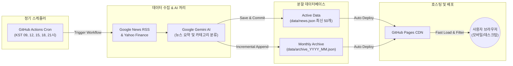

<div align="center">

# 🌐 Econ Gravity
### AI 기반 글로벌 & 국내 경제 뉴스 자동 브리핑 서비스

[](https://github.com/HenryParkG/econ-gravity/actions/workflows/daily_news.yml)
[](https://henryparkg.github.io/econ-gravity/)
[](https://ai.google.dev/)
[](https://pages.github.com/)
[](https://opensource.org/licenses/MIT)

<p align="center">
  <b>매일 5회, 최신 경제 뉴스를 자동으로 수집·요약하여 핵심 인사이트를 실시간으로 전달합니다.</b><br>
  유료 백엔드 서버 없이 GitHub Actions와 GitHub Pages만으로 완전 자동 영구 구동되는 100% 서버리스 웹 서비스입니다.
</p>

[🌐 웹사이트 방문하기](https://henryparkg.github.io/econ-gravity/) • [✨ 주요 기능](#-주요-기능) • [🏗️ 시스템 아키텍처](#️-시스템-아키텍처) • [🚀 로컬 실행 방법](#-로컬-실행-방법)

</div>

---

## 📌 개요 (Overview)

**Econ Gravity**는 쏟아지는 방대한 경제·금융 뉴스 속에서 투자자와 기획자, 개발자에게 필요한 핵심 정보를 AI가 신속하고 명확하게 요약해 주는 서비스입니다.

* **완전 무인 자동화**: 사람이 직접 글을 쓸 필요 없이 스케줄러가 매일 정해진 시간마다 뉴스를 수집 및 요약합니다.
* **비용 0원 서버리스**: 별도의 클라우드 서버(AWS EC2, Docker 등) 비용 없이 GitHub 인프라만으로 영구 구동됩니다.
* **초고속 웹 브라우징**: 최신 50개 뉴스는 즉시 렌더링하고, 과거 뉴스는 월별 아카이브로 온디맨드 분할 로드하여 최적의 웹 성능을 보장합니다.

---

## ✨ 주요 기능 (Key Features)

| 기능 | 설명 |
| :--- | :--- |
| **🤖 AI 심층 뉴스 요약** | Google Gemini API가 복잡한 경제 이슈의 핵심 요점, 영향, 배경을 3줄 내외로 간결하고 정확하게 요약 |
| **🏷️ 스마트 카테고리 분류** | 거시경제, 증시·금융, 빅테크·AI, 부동산, 글로벌 공급망 등 뉴스 주제를 자동으로 분류 |
| **📸 고화질 스톡 포토 큐레이션** | 깨짐이나 품질 저하가 없는 금융/경제 전문 고화질 비주얼 이미지 라이브러리 연동 |
| **⚡ 투-티어 DB 아키텍처** | 빠른 웹 로딩을 위한 활성 데이터(`news.json`)와 무제한 보관용(`archive_YYYY_MM.json`)의 이원화 분할 저장 |
| **💎 글래스모피즘 반응형 UI** | 모바일/데스크탑에 최적화된 다크 모드 글래스모피즘(Glassmorphism) 디자인, 카테고리 칩 필터, 뉴스 상세 팝업 모달 |
| **⏰ 정밀 정기 발행 스케줄** | 한국 시간(KST) 기준 하루 5회 (`09:00`, `12:00`, `15:00`, `18:00`, `21:00`) 자동 배포 |

---

## 🏗️ 시스템 아키텍처 (System Architecture)



---

## 📂 프로젝트 구조 (Directory Structure)

```bash
econ-gravity/
├── .github/
│   └── workflows/
│       └── daily_news.yml        # 하루 5회 자동 수집 및 커밋 배포 워크플로우
├── data/
│   ├── news.json                 # 웹사이트 메인 화면용 최신 50개 뉴스
│   ├── archive_index.json        # 월별 아카이브 메타데이터 색인
│   ├── archive_2026_*.json       # 연도/월별 누적 뉴스 아카이브 데이터
│   └── news_images/              # 생성 및 큐레이션된 뉴스 이미지 캐시
├── pages/
│   ├── privacy.html              # 개인정보처리방침
│   └── terms.html                # 이용약관
├── scripts/
│   └── fetch_news.py             # RSS 수집, Gemini AI 요약 및 JSON 빌드 스크립트
├── app.js                        # 프론트엔드 비즈니스 로직 (필터링, 모달, 더보기 페이징)
├── index.html                    # 메인 레이아웃 및 뷰 구조
├── style.css                     # 글래스모피즘 스타일시트 및 애니메이션
└── PROJECT_HANDOVER.txt          # 프로젝트 설계 인계 문서
```

---

## 🚀 로컬 실행 방법 (Local Development)

### 1. 저장소 복제 (Clone)
```bash
git clone https://github.com/HenryParkG/econ-gravity.git
cd econ-gravity
```

### 2. 가상환경 구성 및 의존성 설치
```bash
python -m venv .venv
# Windows
.\.venv\Scripts\activate
# Mac / Linux
source .venv/bin/activate

pip install feedparser google-genai yfinance Pillow
```

### 3. 환경 변수 설정
로컬에서 뉴스 수집 스크립트를 직접 실행하려면 [Google AI Studio](https://aistudio.google.com/)에서 발급받은 API 키가 필요합니다:
```powershell
# Windows PowerShell
$env:GEMINI_API_KEY="your-gemini-api-key"

# Linux / Mac
export GEMINI_API_KEY="your-gemini-api-key"
```

### 4. 수집 스크립트 테스트
```bash
python scripts/fetch_news.py
```
성공적으로 완료되면 `data/news.json`과 월별 아카이브 파일이 업데이트됩니다.

### 5. 웹 페이지 미리보기
별도의 빌드 도구 없이 `index.html`을 브라우저로 바로 열거나, VS Code의 Live Server 확장을 사용하여 확인할 수 있습니다.

---

## ⚙️ GitHub Actions 자동 배포 환경 설정

저장소를 포크하거나 새로 구성할 때 아래 설정을 완료하면 자동으로 무인 운영됩니다:

1. GitHub 저장소의 **Settings** ➡️ **Secrets and variables** ➡️ **Actions** 이동
2. **New repository secret** 클릭
   * Name: `GEMINI_API_KEY`
   * Value: Google AI Studio에서 발급받은 API 키
3. GitHub 저장소의 **Settings** ➡️ **Pages** 이동
   * Build and deployment Source: `Deploy from a branch`
   * Branch: `main` / `/(root)` 선택 후 **Save**

---

## 🛠️ 기술 스택 (Tech Stack)

| 영역 | 사용 기술 |
| :--- | :--- |
| **AI & NLP** | Google Gemini 2.5 / 2.0 (Google GenAI SDK) |
| **Backend & Crawling** | Python 3.10+, Feedparser, yFinance, Pillow |
| **CI / CD & Infra** | GitHub Actions, GitHub Pages (Serverless) |
| **Frontend** | HTML5, CSS3 (Glassmorphism, CSS Grid/Flexbox), Vanilla Modern JavaScript (ES6+) |
| **Typography & Assets** | Pretendard Font, Twemoji, Unsplash Stock Photography |

---

<div align="center">
  <sub>Developed & Maintained with passion by <b>Hyunsung Park (@HenryParkG)</b></sub>
</div>
